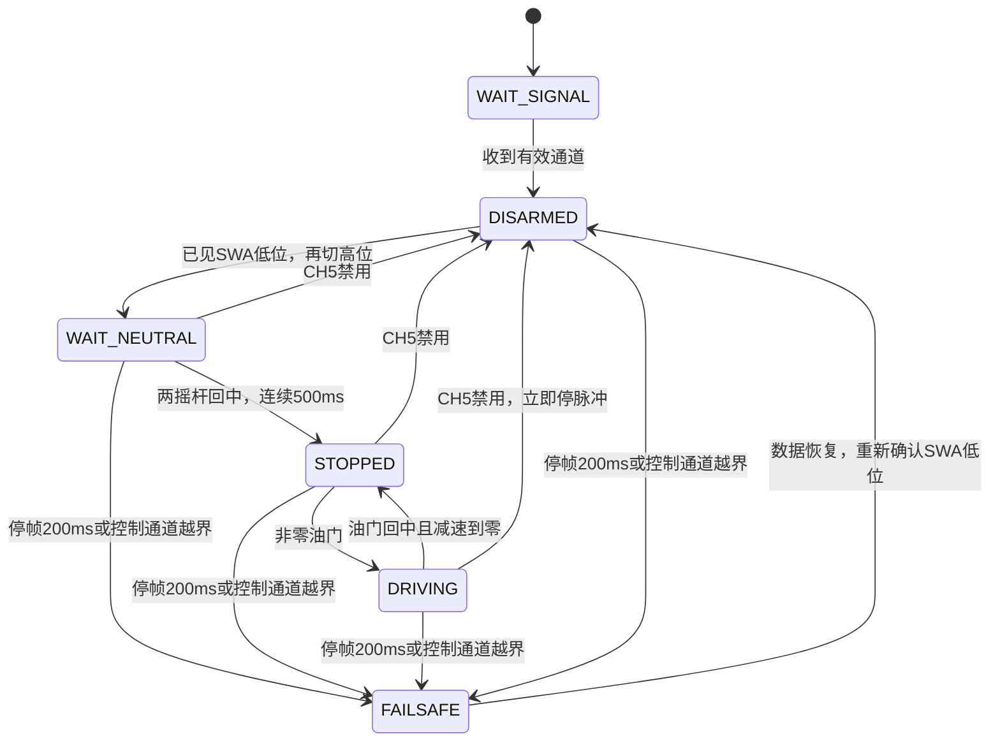

# Motor_HAL_REBULD — 四轮小车电机驱动工程

STM32F407ZGT6 裸机（无 RTOS）四轮驱动工程：四路步进/脉冲输出、S 曲线动作接口、非阻塞遥控调速、差速转向、双串口收发。
代码按 **Config → Osal → Bsp → Service → App** 分层，硬件相关代码全部集中在 Bsp 层。

> **阅读路线（交给接手人的话）**
> - 想快速跑起来 → **§4 快速上手**
> - 想理解现有架构与每层边界 → §2 概览 + **§8 架构详解**
> - 准备继续开发（上位机通信 / 深度相机 / 操作系统）→ 直接看 **§9 后续开发指南**
> - 本文档描述当前代码；§9 是后续开发路线，其中 X1 串口错误恢复、X2 双串口分发已补；遥控版的上板验收见 §3.5，后续事项见各项说明。

---

## 1. 平台与硬件

| 项 | 参数 |
|---|---|
| MCU | STM32F407ZGT6，Cortex-M4F |
| 系统时钟 | 168 MHz（HSE 8 MHz → PLLM 8 / PLLN 336 / PLLP 2） |
| 时基 | **TIM6 产生 1 ms 节拍**（`HAL_IncTick`），SysTick 中断为空 |
| 构建 | CMake + Ninja + arm-none-eabi-gcc（`Debug` / `Release` 两个 preset） |
| 调试串口 | USART1，115200 8N1，PB6=TX / PB7=RX（AF7） |
| 遥控串口 | USART3，115200 8N1，仅 RX=PB11（AF7），接 FS-iA6B 的 SERVO i-BUS 信号 |

### 定时器 / 引脚映射

| 轮位 | 通道枚举 | 脉冲引脚 | 定时器 | 定时器时钟 | 方向引脚 |
|---|---|---|---|---|---|
| 左前 FL | `MOTOR_CH_L1` | PE9（TIM1_CH1） | TIM1 | 168 MHz | PE10 |
| 左后 RL | `MOTOR_CH_L2` | PE11（TIM1_CH2） | TIM1 | 168 MHz | PE12 |
| 右前 FR | `MOTOR_CH_R1` | PA0（TIM2_CH1） | TIM2 | 84 MHz | PA2 |
| 右后 RR | `MOTOR_CH_R2` | PA1（TIM2_CH2） | TIM2 | 84 MHz | PA3 |

**关键约束：同侧两轮共用一个定时器，永远同频。** 左右可以不同（差速转向），但左侧两轮、右侧两轮不能分别调速。

脉冲频率公式（`ARR` 固定 99，即 100 个计数）：

```
f_pulse = tim_clk / ((PSC + 1) × 100)
```

例：2500 Hz → 左侧 PSC = 671，右侧 PSC = 335。占空比固定 50%。

> 工程没有连接驱动器 ENA。SWA/失联停车关闭的是 PUL 脉冲，不是切断电机电流。
> M860D V4.0 手册允许 ENA+/ENA- 默认悬空；静止时仍可能保持力矩，不能据此判断程序还在发脉冲。

### M860D V4.0 驱动器核对

2026-10-28 已取得主动驱动的带载对照：PA3 请求并读回高，A5=3.32V，但接正常右后 DIR 输入的 B5 仅 2.67V，
低于手册有效高电平 >3.5V 的要求。当前转换输出与该负载/接法的匹配存在问题，尚不能据此单独判定右前驱动器损坏。
替换规格及拟共阳极接法见 [M860D 控制信号驱动模块方案](docs/m860d-signal-driver.md)。方案待实施，未更换模块或验收实际转向。
当前 PA3→A5、B5→右后 DIR+ 为临时测试接线，驱动主电源保持关闭，改接前控制系统也须断电。

- 当前使用 PUL+DIR 单脉冲模式：**SW9=OFF**。使用 5V 信号转换输出时，输入电平滑拨选 **5V**，不可保持出厂 24V 档。
- 手册控制时序图要求高电平 **>3.5V**、低电平 **<0.5V**，光耦输入电流 7～20mA。STM32 3.3V GPIO 直连不保证满足要求；应核对现有电平转换/差分驱动板的供电、输出幅值及接线。
- DIR 应在有效脉冲下降沿前至少稳定 5µs，脉冲高/低时间各至少 2.5µs。遥控默认最高 2500Hz、50% 占空比，高/低各约 200µs；仍需在转换板输出及驱动器端测量实际波形。
- SW1～SW3 的电流按**实际电机铭牌**设置，不按驱动器最大 7.2A 直接设置；SW5～SW8 的每转脉冲数也要记录。转速估算为 `Hz × 60 / 每转脉冲数`，还未计机械减速比。
- SW4=OFF 时，停止接收脉冲约 0.4 秒后自动半流；这只是降低保持电流，不是释放电机轴。
- 持续嗡响/抖动不转需核对实际固件、PUL 波形、相线配对、限流、供电和机械负载。改接电机相线或拨码前关闭驱动电源，不带电插拔电机端子。
- 正常为绿灯常亮、红灯启动短闪后熄灭；若红灯周期闪烁，记录每 5 秒内的次数，再按实际型号手册排查。

上述参数来自用户提供的《M860D V4.0 步进使用说明书 V2.0》§2.1、§3.1～3.3、§4；PDF 第4～7页为双页排版，对应印刷页5～12。

2026-10-27 用户报告的拨码：SW1～SW8 依次为 **OFF、ON、OFF、ON、ON、OFF、ON、ON**。
按该手册对应运行电流峰值 **5.83A**／有效值 **4.86A**、静止保持约 90% 峰值电流、**1600 脉冲/转**。
当前遥控最高 2500Hz 对应电机轴约 93.75rpm（未计减速比），以上为现场拨码记录，不作为通用拨码建议。

用户提供的《86CM45D》电机图纸参数：额定相电流 6.0A、步距角 1.8°、保持转矩 4.6N·m。
该型号图纸相线为 **A+ 黑、A− 红、B+ 黄、B− 蓝**；仅适用于该图纸型号，不推及其他电机线色。
图纸列出的 3.6V 是电机参数，不是要求将 M860D 驱动电源改接 3.6V。
用户确认同一套电机、驱动器和接线在加遥控前能够正常转动；排查优先比较调频过程，未调整现有电流拨码。

---

## 2. 软件架构

```
   ┌────────────────────────────────────────────────────┐
   │  App/         应用：遥控状态机·运动学·集成点     │
   └──────────────────────────┬─────────────────────────┘
                              │
   ┌──────────────────────────▼─────────────────────────┐
   │  Service/     通用服务：文本协议 / i-BUS / 日志           │
   └──────────────────────────┬─────────────────────────┘
                              │
   ┌──────────────────────────▼─────────────────────────┐
   │  Bsp/         板级：定时器/引脚/串口翻译              │
   └──────────────────────────┬─────────────────────────┘
                              │ 只被 Bsp/Inc/mx_board.h 引用
   ┌──────────────────────────▼─────────────────────────┐
   │  Osal/        操作系统抽象：延时 / 毫秒计时           │
   └──────────────────────────┬─────────────────────────┘
                              │
   ┌──────────────────────────▼─────────────────────────┐
   │  CubeMX 盒子                                        │
   │    Core/      启动 / 外设初始化 / 中断向量            │
   │               main.c · tim.c · gpio.c · usart.c     │
   │               （只放生成代码 + USER CODE 段）         │
   │    Drivers/   ST HAL/LL 驱动 + CMSIS                │
   └────────────────────────────────────────────────────┘

   Config/  编译期常量（类型、时钟、限幅、S 曲线参数）—— 横切，任何层都可以 include
```

依赖方向**只能向下**：App → Service → Bsp → Osal → CubeMX。不出现反向 include。
（图中越靠上越是上层，箭头方向 = 依赖/调用方向。）

### 各层职责

| 层 | 目录 | 职责 | 对外入口 |
|---|---|---|---|
| **Config** | `Config/Inc/` | 编译期常量：类型、电机/时钟、运动参数，以及 `cfg_rc.h` 遥控通道/限速/保护设置 | 纯头文件 |
| **Osal** | `Osal/` | 唯一允许直接调 `HAL_Delay` / `HAL_GetTick` 的地方 | `Osal_DelayMs()` `Osal_GetTickMs()` |
| **Bsp** | `Bsp/` | 板级封装：通道→定时器/引脚翻译、方向电平、PSC 计算、串口收发 | `Bsp_MotorPulse_*` `Bsp_Uart_*` |
| **Service** | `Service/` | 与硬件无关的通用服务：串口帧解析状态机、`printf` 重定向 | `Protocol_*` `LOG()` |
| **App** | `App/` | 业务：遥控状态机、运动学、系统集成点 | `RcControl_*` `Motion_*` `App_Init()` `App_Loop()` |
| **Core** | `Core/` | CubeMX 生成的初始化与中断向量；业务代码只写在 `USER CODE` 段 | `main()` |

### 两条重要规矩

1. **CubeMX 头文件（`main.h` / `tim.h` / `usart.h`）只允许在 `Bsp/Inc/mx_board.h` 里 include**，其他层用 `BOARD_HTIM_LEFT`、`BOARD_HUART_HOST` 这类别名。这样重新生成代码不会波及上层。
2. **`App/Src/app_init.c` 是全工程唯一集成点**：`main()` 只调 `App_Init()` 和 `App_Loop()`。

### 构建体系

根 `CMakeLists.txt` 把每层编译成 **OBJECT 库**（不是静态库）：

```
cfg / osal / bsp / service / app   ← 每层一个 OBJECT 库，编译期就带好各自的 include 路径
        ↓
可执行目标 Motor_HAL_REBULD        ← 链接 cube(Core+Drivers) + 五个 OBJECT 库
```

用 OBJECT 库而不是静态库，是为了避免静态库的链接顺序问题（层之间有符号交叉引用时，静态库要用 `--start-group` 才能解出全部符号）。OBJECT 库整包交给链接器，配合 `--gc-sections` 自动丢弃没用到的函数。

Debug 构建：`-O0 -g3`，同时生成 `.map` 和每个文件的 `.su`（栈用量）报告。

---

## 3. 已有功能与调用方式

### 3.1 运动控制 API（`App/Inc/motion.h`）

单位是**脉冲频率 Hz**，不是 mm/s。正数前进、负数后退、0 停止。

| 函数 | 说明 |
|---|---|
| `Motion_Init()` | 初始化四路输出，内部速度状态清零（`App_Init` 已调用） |
| `Motion_Drive(s32 speed, u32 holdMs)` | **进退**：正=前进、负=后退、0=停；左右同速走直线 |
| `Motion_Steer(s32 vLeft, s32 vRight, u32 holdMs)` | **转弯/差速**：左>右 = 右转，右>左 = 左转，相等 = 直行 |
| `Motion_Brake()` | **停车**：两侧 S 曲线降到 0 |
| `Motion_Move(s32 vLeft, s32 vRight)` | 底层：立即生效，不平滑，调用者自己负责过渡 |
| `Motion_GetSpeed(s32 *l, s32 *r)` | 底层：读回当前已下达的速度 |
| `Motion_SetTarget(s32 l, s32 r)` | 遥控路径：设置非阻塞左右目标速度 |
| `Motion_Tick(u32 nowMs)` | 按周期推进限加速度调速，每侧换向先经过零速 |
| `Motion_StopImmediate()` | 立即关闭脉冲、清空目标；SWA 禁用及故障使用 |
| `Motion_SetAccel(u32 hzPerSec)` | 改加速度，对后续变速立即生效；传 0 被忽略 |
| `Motion_GetAccel()` | 读回当前加速度 |

`Motion_Drive / Steer / Brake` 都是**阻塞**动作，语义固定为：

```
S 曲线变速（时长由加速度决定）→ 到达目标速度 → 保持 holdMs → 返回
```

**变速耗时不计入 `holdMs`**。起始速度不用传，本层内部记住“当前已下达速度”，自动从那里开始过渡。

```c
#include "motion.h"

Motion_Drive(2500, 1000);        /* 从当前速度 S 曲线加速到 2500Hz，到位后保持 1 秒 */
Motion_Steer(1000, 2500, 1000);  /* 左轮 1000、右轮 2500 → 左转，保持 1 秒 */
Motion_Steer(2500, 1000, 1000);  /* 反过来 → 右转 */
Motion_Drive(-2500, 2000);       /* 穿零换向倒车到 -2500Hz，保持 2 秒 */
Motion_Brake();                  /* S 曲线降到 0 */
```

### 3.2 S 曲线变速

- 曲线表：`App/Src/motion.c` 里 101 点余弦 S 曲线（0～1000 的千分比），两端斜率为 0。
- 加速度：`Config/Inc/cfg_motion.h` 的 `CFG_SCURVE_ACCEL_HZ_PER_S`（默认 **2000 Hz/s**，即“1000 Hz 用 500 ms”）。
- 变速时长 = `两侧速度差中较大者 × 1000 / 加速度`，下限 `CFG_SCURVE_MIN_MS`（20 ms）。
- 按真实经过时间推进（`Osal_GetTickMs`），不靠数循环次数，`DelayMs` 抖动不会累积。
- 左右共用同一条进度曲线 → 差速转向时两轮同时到位，轨迹不歪。
- 运行期可调，不用重烧：

```c
Motion_SetAccel(4000);   /* 变速快一倍：0 → 2500Hz 用 625ms */
```

### 3.3 上电行为：保持停车

`main()` 完成 GPIO / TIM1 / TIM2 / USART1 / USART3 初始化后，只调用 `App_Init()` 和循环中的 `App_Loop()`。
原来的六段自动演示已取消。复位、接收机未连接、SWA 禁用或尚未回中解锁时，都不输出电机脉冲。

遥控主循环只调用 `Motion_SetTarget()`、`Motion_Tick()` 和 `Motion_StopImmediate()`，不调用会阻塞的
`Motion_Drive/Steer/Brake`。旧的 S 曲线 API 保留供单独动作测试使用，不能混入遥控主循环。
遥控调速采用每秒最多 2000 Hz 的速度变化，不是旧的整段余弦 S 曲线；一个延迟更新最多按 20 ms 推进。

底层停车直接清除 TIM1/TIM2 的 `CR1.CEN` 及对应两路 `CCER.CCxE`。不能依赖 `HAL_TIM_Base_Stop()`：
它内部的 `__HAL_TIM_DISABLE()` 在 PWM 通道仍开启时会保留 CEN。初始化也不再调用会短暂起转的 `HAL_TIM_PWM_Start()`。
非零频率先加载 PSC，再开启对应一侧，另一侧保持停止。

运行中调频仅写 PSC 预装载值，在下一次自然溢出时生效；不再反复触发 `EGR.UG`。
`UG` 会重置计数相位，摇杆小幅波动、每 8ms 调频时，可能打断低速完整脉冲。
例如 50～60Hz 的半周期大于 8ms，连续强制更新可能使脉冲始终无法到达下降沿。
只有停止后重新启动时，才在开启输出前触发 UG 装载首个频率。
运行调频最多等待一个当前周期（30Hz 时约 33.3ms），禁用/故障停车仍立即清 CEN、关闭通道。
语义依据：ST RM0090 的 TIMx_EGR 与预分频器缓冲说明；主机测试同时覆盖定时器相位模型中的有效步进边沿。

### 3.4 串口

当前调试串口固定为 **USART1：PB6=TX、PB7=RX**，对应本核心板 **J3 第4脚、第3脚**。
外部串口的 RX 接 PB6，TX 接 PB7，并共地。PB6/PB7 专用于串口，不接摄像头对应信号。
旧 PA9/PA10 保留为无上下拉的普通输入；板载 CH340G 与 J5（PA9/PA10）不作为本版固件的调试串口。

- **接收**：USART1 中断逐字节收，`HAL_UART_RxCpltCallback` → `Protocol_FeedByte()` 组帧。
  帧规则：**以 `0x0D 0x0A`（回车 + 换行）结尾**，缓冲区 `PROTOCOL_FRAME_MAX`（200）字节，正文最多 199 字节。
- **回显**：`App_Loop()` 取到完整帧后打印 `RX: <内容>`。目前没有上位机运动命令解析，USART1 只回显，不能绕过遥控使能。
- **发送**：`LOG("...")` → `printf` → `__io_putchar()` → `Bsp_Uart_SendByte()`（阻塞发送，不占中断）。
- 主循环里上一帧没被取走时，新来的字节会被丢弃（不排队）。
- **启动提示**：复位后直接发送 `BOOT: USART1 115200 8N1, TX=PB6 RX=PB7`，随后输出 PB11 遥控配置、通道映射及 `UART ready`。日志设为无缓冲输出，不再等待自动演示。
- **错误恢复**：`HAL_UART_ErrorCallback()` 中终止当前中断接收、清错误标志、重新开启单字节接收；不在中断中打印。出错当时的数据仍可能丢失。

串口助手设为 **115200 / 8N1 / 无流控**，关闭本地回显，启用发送末尾追加 **CRLF**。等待 `UART ready` 后发送 `hello`，应收到 `RX: hello`。
也可用十六进制模式发送 `68 65 6C 6C 6F 0D 0A`，排除结束符设置问题。
若复位后连 `BOOT` 都没有，先检查 PB6 → 转串口 RX、PB7 ← 转串口 TX、共地、COM 口和固件是否正在运行（F5 停在 main 时需继续运行）。若有 `BOOT` 却没有 `UART ready`，检查程序是否停在断点或进入故障处理。

源码配置正确但板上没有输出时，还需确认烧录的是当前固件：`build/Debug/Motor_HAL_REBULD.elf`。
F5 选择“无线调试器：下载并调试”，而“仅连接（不烧录）”不会更新 Flash。
曾实测发现板上运行旧 PA9/PA10 固件、与当前 ELF 的 `.text` 段不匹配；重新烧录后，XCOM V2.2 正常显示 PB6/PB7 启动提示及 `RX: hello`。
使用 XCOM 时发送框只填 `hello`，勾选“发送新行”；文本模式下手写 `0D 0A` 是普通字符，不是回车换行字节。

```c
LOG("boot ok, clk=%lu\r\n", (unsigned long)SystemCoreClock);   /* 任意位置都能用 */
```

### 3.5 FS-i6X / FS-iA6B 遥控与状态机

当前操控约定：**右摇杆上下控制前进/后退；左摇杆左右控制差速转向，油门回中时可低速原地转向；两个摇杆都回中停车；SWA/CH5 数值低时禁用、数值高时允许运动。**

2026-10-27 当前这台遥控器已实测：**SWA 朝上 → CH5≈1000，禁用；SWA 朝下 → CH5≈2000，使能。**
本文后续“低位/高位”均指 CH5 数值，不是开关的物理上下方向；更换模型或设置通道反向后需重新核对。
使能且两摇杆回中后状态为 `STOPPED`，仍不输出电机脉冲。

#### 接线与遥控器设置

| FS-iA6B | STM32 / 电源 | 说明 |
|---|---|---|
| SERVO i-BUS 的信号 S | PB11 / USART3_RX | 单向接收全部通道，不接 PB10 |
| 电源正极 + | 稳压 5V | 与外壳电压范围相符，不用 3.3V 给接收机供电 |
| 电源负极 - | GND | 接收机、STM32、电源共地 |

按接收机实际 S/+/- 标记确认针序；SENS 是传感器接口。USART1 PB6/PB7 继续用于 XCOM 调试，不能把 i-BUS 信号并接到 PB7。

FS-i6X 中文菜单示例：进入“辅助通道”，将“**通道5 → 控制：VrA**”改为“**控制：SwA**”，长按 CANCEL 保存。
VrA 是顶部旋钮；若仍选择 VrA，拨动 SWA 不会改变 CH5。仅进入“开关分配”菜单不等于把 CH5 的来源改为 SwA。
若来源列表没有 SwA，先到“**系统设置 → 辅助开关**”（System setup → Aux switches）启用 SwA，并保存，再回来分配通道5。
遥控器手册 §7.13 说明辅助开关需要先激活；VrA/VrB 旋钮默认已开启。

配置集中在 `Config/Inc/cfg_rc.h`，通道编号从 **1** 开始：

| 配置 | 默认值 | 含义 |
|---|---|---|
| `CFG_RC_THROTTLE_CH` | 3 | 当前遥控器实测右摇杆上下对应 CH3；标准 Mode 2 常为 CH2，换模型后重新核对 |
| `CFG_RC_STEERING_CH` | 4 | 当前配置的左摇杆左右，仍需结合通道显示确认 |
| `CFG_RC_ENABLE_CH` | 5 | 在遥控器 Aux channels 中把 SWA 分配给 CH5 |
| `CFG_RC_THROTTLE_REVERSE` | 0 | 上推应使 T 为正；相反时改成 1 |
| `CFG_RC_STEERING_REVERSE` | 0 | 右推应使 S 为正；相反时改成 1 |
| `CFG_RC_INPUT_MIN/CENTER/MAX_US` | 1000 / 1500 / 2000 | 输入端点和中点 |
| `CFG_RC_DEADBAND_US` | 50 | 中点 ±50 不产生速度/方向指令 |
| `CFG_RC_ENABLE_LOW/HIGH_US` | 1200 / 1800 | ≤1200 确认为低位，≥1800 为高位，中间位置仍禁用 |
| `CFG_RC_MAX_SPEED_HZ` | 2500 | 每侧脉冲频率上限，不是车速 mm/s |
| `CFG_RC_PIVOT_MAX_HZ` | 600 | 油门回中时满方向指令的原地转向频率；也作为低速转向计算的幅度下限，设 0 可恢复禁止原地转向 |
| `CFG_RC_FRAME_TIMEOUT_MS` | 200 | 从最后一帧校验成功数据起的停帧超时 |
| `CFG_RC_NEUTRAL_HOLD_MS` | 500 | 油门和方向都回中、保持有效连续数据后解锁 |
| `CFG_RC_NEUTRAL_MAX_GAP_MS` | 50 | 回中计时允许的最大帧间隔，超过则重新计时 |
| `CFG_RC_LOG_PERIOD_MS` | 500 | 调试状态输出周期；状态改变也会输出 |

**必须设置失控保护：** 在 FS-i6X 的接收机 Failsafe 菜单中，将 **CH5 设为 1000（通常是 -100%）**，
并建议把油门、方向设为 1500（中位）。以串口显示的实际通道值为准，不能保留 Hold/维持最后值。
FS-iA6B 无线失联时可能仍持续发送 i-BUS 帧，这种情况无法用“200 ms 无帧”识别，必须依靠接收机把 CH5 输出为禁用值。
若接收机停帧，才由软件的 200 ms 看门超时停车；软件检查在主循环运行时执行，并非独立硬件看门狗。
协议和这一失联特性的参考：[IBusBM 协议说明及 Failsafe](https://github.com/bmellink/IBusBM#failsafe)。本工程独立实现解析，不依赖 Arduino 库。

#### 状态机



- 上电时即使 SWA 已在高位，也保持禁用；需要先拨低，再拨高，两摇杆回中 500 ms。
- `WAIT_NEUTRAL` 的计时只由新帧推进，反复读取同一帧不能解锁；摇杆离开中位或帧间隔超过 50 ms，重新计时。
- 正常油门回中采用限加速度减速停车；**SWA 禁用、串口停帧、控制通道越界立即关闭脉冲并清除旧目标**。
- 故障恢复后不会按旧油门自动续跑，必须重新完成低位确认和回中解锁。
- 转向通过左右差速实现：正方向值使车头右转，负值使车头左转，包括倒车。
- 油门回中且已解锁时，方向指令使两侧反向转动，满方向最多各 600Hz；左右摇杆均回中后减速停车。
- 转向幅度按 `max(abs(油门对应频率), CFG_RC_PIVOT_MAX_HZ)` 乘以方向比例计算，低速与原地转向平滑衔接；各侧换向仍先经过零速。
- 转弯时按比例压缩两侧目标，确保都不超过 2500 Hz；前后换向时每一侧先减到零，再反向加速。
- 指令是开环脉冲频率，不代表实际轮速；立即停脉冲也不等同于机械制动。

#### 数据链路与诊断

`USART3_IRQHandler -> HAL 回调按 Instance 分发 -> Ibus_FeedByte -> 最新完整帧 -> RcControl_Tick -> Motion_Tick -> Bsp`。
USART1 文本回显独立分发，不执行电机命令。i-BUS 采用 115200 8N1、32 字节 `20 40` 帧、14 路小端值及校验和；
坏校验不更新有效帧时间，丢字节/插字节会寻找下一帧头。只保留最新控制帧，不排队执行过期摇杆指令。
ISR 与主循环之间的帧和统计快照由 OSAL 短临界区保护；中断只处理接收，不打印日志、不驱动电机。

串口每 500 ms 或状态变化时输出类似：

```text
RC STOPPED ch1-6=1500,1500,1000,1500,2000,1000 T=0 S=0 L=0 R=0 age=3 frames=100 bad=0 uart_err=0 need_low=0
```

`ch1-6` 用来核对实际摇杆映射；T/S 为 -1000～1000 的归一化指令；L/R 为当前已下达的左右脉冲频率；
`frames` 应持续增长，`bad` 是坏校验帧累计数，`uart_err` 是 USART3 错误恢复次数。
`need_low=1` 表示必须先看到 SWA 低位。`WAIT_SIGNAL` 且 frames=0 时检查 SERVO S→PB11、共地、电源和对码。

#### 验证顺序

1. 首次烧录/测试时架空车轮，SWA 保持低位。上电应保持停车，无六段演示。
2. 在 XCOM 115200 8N1 中查看 `ch1-6`，逐个操作右摇杆上下、左摇杆左右和 SWA，核对当前配置 CH3、CH4、CH5；不符则先改配置。
3. 设置接收机 CH5 失控保护为 1000。SWA 先低后高，两摇杆回中 500 ms，应显示 `STOPPED`。
4. 小幅推动油门和方向，检查前进、后退、行驶转向及回中减速；油门回中后单独小幅拨左摇杆，检查低速原地转向。两个摇杆都回中应停车。方向相反时改 REVERSE 配置，不在接收机引脚上调换正负极。
5. 行驶时将 SWA 拨低，应立即停止脉冲；重新拨高但摇杆未回中时不应启动。
6. 架空状态下测试拔掉 PB11 信号线，最后有效帧 200 ms 后应进入 `FAILSAFE` 并停车；恢复信号后需重新解锁。
7. 单独测试关闭遥控器：接收机可能仍发帧，但 CH5 必须变为 1000，状态进入 `DISARMED` 并停车。若 CH5 未变，先修正 Failsafe 配置。

主机测试（不接触开发板）：`python tests/test_rc_control.py`。它编译并执行真实 C 解析器、状态机、运动代码和带寄存器模型的 Bsp，
覆盖校验/重同步、回中解锁、断流、CH5 失控值、方向切换、毫秒回绕及停车时关闭 CEN/CCER。Windows 需 host clang/lld，
可用环境变量 `RC_TEST_CLANG` 指定；固件仍使用工程原有 ARM GCC 工具链。主机测试不能代替真实接收机、引脚波形和车辆上板测试。

2026-10-26 驱动断电验证：新固件已烧录并校验；PB11 收到真实 i-BUS 帧。禁用状态下 TIM1/TIM2 的 CEN=0、CCER=0，
Flash 与新 ELF 导出的镜像一致。此前板上是旧演示固件，停车后两侧仍约 30Hz，不能把旧固件的电机现象当作新版遥控状态机结果。
此项验证不包含电机动力上电、实际行驶和关闭遥控器的失控保护验收。

2026-10-27 补充验证（驱动电源关闭）：SWA 朝下、CH5=2000、摇杆回中时为 `STOPPED`；
关闭遥控器后 i-BUS 有效帧停止增长，状态进入 `FAILSAFE`，左右目标为 0，TIM1/TIM2 的 CEN=0、CCER=0。
本次验证了真实无线断联时的断帧停车；CH5=2000 是最后一帧旧值，未据此确认接收机输出过 CH5=1000 的失控帧。
恢复连接仍有异常：遥控器重新开机、接收机红灯常亮后，曾出现 PB11 无有效帧，程序保持停车；
仅对接收机断电约 3 秒再上电后，有效帧恢复增长，CH5=1000、状态 `DISARMED`，脉冲保持关闭。
此过程验证了接收机重启后的安全恢复，尚未通过无需重启的自动重连验收；原因尚未确定。
驱动上电静止检查：用户确认车轮架空、SWA 朝上禁用、摇杆回中时，静止稳定，无明显抖动或持续嗡响。
带脉冲转动检查未通过：用户报告小幅上推油门后四个电机均嗡响、抖动，基本无法转动，已回中禁用并关闭驱动电源。
正在核对 M860D 的电流/细分拨码、转换板与 PUL/DIR 接线；原因尚未确定，不能据定时器寄存器正确推断驱动端波形及相线正确。
实际行驶尚未验收。

2026-10-27 低速调频修复：回归测试在修复前复现了 50～60Hz 指令连续更新时丢失完整脉冲；
修复后 25 项主机测试与 ARM Debug 构建通过，已烧录并校验（Flash 27956B、RAM 3800B）。
烧录后 CH5=1000、`DISARMED`，有效帧持续增长、两侧 CEN/CCER 为 0。
后续用户确认已能前进后退，但右前轮仅在后退时与另外三轮方向不同，该现象仍在排查，未采用全程反相补偿。

原地转向追加修改：已解除油门回中时的转向限制，默认满方向限速 600Hz；28 项主机测试与 ARM Debug 构建通过，
已烧录并校验（Flash 27972B、RAM 3800B）。当前数字端仍保持禁用停车，实际原地转向效果待架空验收。

随后持续下拉右摇杆采样得到 CH2=1509、CH3=1135、CH4=1528、CH5=2000，说明这台遥控器当前右摇杆上下对应 CH3。
已将油门配置由 CH2 修正为 CH3，避免默认 Mode 2 假设与实际模型不一致；该次旧映射样本未产生后退指令，不能作为右前 PA2 的后退电平证据。
CH3 映射已编译、烧录并校验，29 项主机测试通过。
新映射后持续下拉实测状态 `DRIVING`、左右目标约 −1000Hz；GPIOA ODR=0x0C，PA2/PA3 均写高，
但多次 IDR 采样的 PA2 为低、PA3 为高（如 IDR=0x4608），PA2/PA3 均为推挽输出。
右前方向线存在“输出写高而引脚采样为低”的异常，正在隔离外接信号线检查；未将整轮前后方向一并反相。
用户确认转换板在驱动断电时仍有独立供电。断开开发板 PA2→转换板信号线后，以真实后退指令复测，
GPIOA ODR=0x0C、IDR=0x460F，PA2 恢复读回高电平。
已将右前异常缩小到外接 DIR 通路，需继续检查信号线、接线与转换通道；尚未定位到具体元件。
目前 PA2 信号线按排查要求保持断开，驱动电源关闭，修复并恢复接线前不做动力验收。

### 3.6 尚未实现 / 已知限制

| 项 | 现状 |
|---|---|
| 上位机命令解析 | USART1 只回显；运动由遥控状态机独占，上位机不能绕过使能控制 |
| 闭环/编码器 | 无，纯开环脉冲输出 |
| 驱动器使能引脚 | 无，需硬件接死 |
| 串口错误恢复 | 已补 `HAL_UART_ErrorCallback`，可重新开启中断接收；尚需上板压测，出错时的数据不保证保留 |
| 故障现场 | `Error_Handler()`（`main.c`）和 `HardFault_Handler()`（`stm32f4xx_it.c`）都是 `while(1)`，无输出 |
| 栈余量 | 遥控版主循环局部栈约 416 B，已把主栈预留从 1 KB 增至 2 KB；仍需通过 `.su` 和上板测试核对中断叠加峰值 |
| 多路串口 | 已按 Instance 分发 USART1 文本和 USART3 i-BUS，各自接收与错误恢复 |
| `Protocol_TakeFrame` 返回类型 | 声明为 `u16`，但语义只有 1/0，应为 `u8` |

---

## 4. 快速上手

### 4.1 准备环境

1. **VS Code** + 扩展 **STM32Cube for VS Code**（自带 gcc / cmake / ninja / gdb，装在
   `%LOCALAPPDATA%\stm32cube\bundles\`）。
2. **调试器**（二选一）：
   - **CMSIS-DAP 无线调试器**（正点原子 ATK-HSWLDBG）：OpenOCD 必须放在
     `<工作区>\tools\openocd\bin\openocd.exe`（`scripts/` 与 `bin/` 平级）。工程已自带。
   - **ST-LINK**：装 ST-LINK GDB Server 扩展，另建一条 launch 配置。
3. **串口工具**（波特率 115200），RX 接 PB6、TX 接 PB7，并连接 GND。

### 4.2 编译

**最省事：直接按 F5**。`preLaunchTask: build-debug` 会自动 configure + 编译（`Debug` preset），
编译不过就不会进调试。

也可以在 VS Code 里点 STM32Cube 面板的 **Build** 按钮，等价于：

```
cmake --preset Debug
cmake --build --preset Debug
```

> ⚠️ **不要在 cmd/PowerShell 里直接敲 `ninja` 编译。**
> 本工程路径含中文（`E:\电机驱动_HAL\...`），CMake 生成的链接命令会被 `cmd.exe /C "..."`
> 包一层，中文部分变成 `E:/????_HAL/...`，链接器报
> `cannot open linker script file`，ninja 会卡在链接步不退出。
> 用 IDE 的 Build 按钮（内部走 `cube.exe`，不经过这层 cmd 包装）就不受影响。

产物：`build/Debug/Motor_HAL_REBULD.elf`（遥控版约 28 KB Flash / 3.8 KB RAM，含预留堆栈，以本次构建输出为准），
同目录有 `.map`（符号与内存分布）和各 `.su` 文件（每个函数的栈用量）。

### 4.3 烧写与调试

F5 选 **“无线调试器：下载并调试（OpenOCD + CMSIS-DAP）”**：编译 → 烧录 → 复位 → **停在 `main`**。
另有 **“仅连接（不烧录）”** 配置，用于板子上已在跑固件时挂上去看变量、打断点。

调试要点：

- 外设视图用 `.vscode/STM32F407.svd`，可直接看 `TIM1->PSC`、`GPIOE->ODR` 等寄存器。
- 断点停在 `Motion_RampTo` 里时脉冲会停（调试器默认冻结定时器），**单步观察期间电机不走是正常的**。
- 想看“目标速度 vs 实际寄存器”，用 `Motion_GetSpeed()` 读软件值，再展开 SVD 里的 `TIM1->PSC` 换算。

### 4.4 跑起来看什么

1. 上电保持停车，串口立即显示 `BOOT`、PB11 遥控配置和 `UART ready`，不再自动演示。
2. USART1 发送 CRLF 结尾的文字仍收到 `RX: ...`；USART3 的 `frames` 随接收机数据增长。
3. 按 §3.5 先核对通道，再完成 SWA/回中解锁、运动和失控保护测试；2500 Hz 满速时 PE9 周期约 400 µs、高电平约 200 µs。

### 4.5 改一版自己试

| 想改什么 | 改哪里 |
|---|---|
| 遥控通道、反向、死区、限速、超时 | `Config/Inc/cfg_rc.h`；状态转换在 `App/Src/rc_control.c` |
| 加速度（调速快慢） | `Config/Inc/cfg_motion.h` 的 `CFG_SCURVE_ACCEL_HZ_PER_S`，或运行期 `Motion_SetAccel()` |
| 最大/最小脉冲频率 | `Config/Inc/cfg_motor.h` 的 `CFG_PUL_MAX_HZ` / `CFG_PUL_MIN_HZ` |
| 串口波特率 | `Core/Src/usart.c`（CubeMX 生成，改 `.ioc` 更保险） |
| 换主频 | 改 `.ioc` 重新生成后，**必须同步** `cfg_motor.h` 的 `CFG_TIM1_CLK_HZ` / `CFG_TIM2_CLK_HZ` |

---

## 5. 常见坑

| 现象 | 原因 |
|---|---|
| 改了主频，转速整体偏快/偏慢 | `cfg_motor.h` 的 `CFG_TIM1_CLK_HZ` / `CFG_TIM2_CLK_HZ` 没跟 `SystemClock_Config()` 同步，PSC 算错但代码不报错 |
| 停车后另一侧短暂起转 | 新版 `SetFreq(nonzero)` 只启动对应一侧；不要再调用旧的 `StartAll()` 无条件重启两侧 |
| 改了一次频率就没脉冲输出 | 同侧两路共用定时器，改其中一路会连带改掉另一路；停车用 `SetFreq(ch, 0)` |
| 串口发了没反应 | ① 确认收到 `BOOT` 和 `UART ready`；② 发送必须以 `0x0D 0x0A` 结尾；③ 检查 TX/RX 交叉接线、共地和 COM 口；④ F5 停在 main 或断点时需继续运行 |
| 只改 `Core/` 之外的代码，重新生成 CubeMX 后改动丢失 | 业务代码不要写进 CubeMX 会覆盖的区域，只写 `USER CODE BEGIN/END` 之间 |
| 命令行 `ninja` 卡死 | 中文路径 + `cmd.exe` 包装，见 4.2 的警告 |
| 加了自己的 `.c` 文件，编译通过但功能没生效 | 没把它加进 `CMakeLists.txt` 里对应层的 OBJECT 库源列表——**链接期会静默丢弃，不报错**。见 §9.3 |
| `printf` 输出不出东西 / 一调用就 HardFault | `__io_putchar()` 必须是非 static 的强定义；若它是 `static`，链接器会选 weak 符号（地址 0） |

---

## 6. 目录速查

```
Motor_HAL_REBULD/
├── Core/                  CubeMX 生成：main.c / tim.c / gpio.c / usart.c / 中断向量 / 启动文件
├── Config/Inc/            cfg_motor.h（时钟、限幅） cfg_motion.h（运动） cfg_rc.h（遥控） types.h
│                          （Config/Src/ 目前只有空的 cfg_board.c 占位）
├── Osal/                  osal.c/.h  —— 延时、毫秒计时
├── Bsp/                   mx_board.h（唯一 include CubeMX 头的地方）
│                          bsp_motor_pulse.c —— 通道→定时器/引脚、方向、PSC
│                          bsp_uart.c       —— 中断收字节、阻塞发
├── Service/               protocol.c（文本帧） ibus.c（遥控帧校验） log.c（printf 重定向）
├── App/                   motion.c（运动输出） rc_control.c（遥控状态机） app_init.c（唯一集成点）
├── cmake/                 工具链文件 + CubeMX 生成目录的 CMake
├── tools/openocd/         OpenOCD（F5 调试用）
├── .vscode/               launch / tasks / settings / c_cpp_properties / cube-task.ps1 / SVD
├── CMakeLists.txt         分层 OBJECT 库 + 可执行目标
├── CMakePresets.json      Debug / Release
├── Motor_HAL_REBULD.ioc   CubeMX 工程文件
└── STM32F407xx_FLASH.ld   链接脚本（遥控版 _Min_Stack_Size = 0x800）
```

---

## 7. 对外接口总表

```c
/* App/Inc/motion.h */
void Motion_Init(void);
void Motion_Drive(s32 speed, u32 holdMs);
void Motion_Steer(s32 vLeft, s32 vRight, u32 holdMs);
void Motion_Brake(void);
void Motion_Move(s32 vLeft, s32 vRight);
void Motion_GetSpeed(s32 *vLeft, s32 *vRight);
void Motion_SetTarget(s32 vLeft, s32 vRight);
void Motion_Tick(u32 nowMs);
void Motion_StopImmediate(void);
void Motion_SetAccel(u32 hzPerSec);
u32  Motion_GetAccel(void);

/* App/Inc/rc_control.h */
void RcControl_Init(u32 nowMs);
void RcControl_Tick(u32 nowMs);
void RcControl_GetStatus(RcControlStatus *out);
const char *RcControl_StateName(RcState state);

/* App/Inc/app.h */
void App_Init(void);
void App_Loop(void);

/* Bsp/Inc/bsp_motor_pulse.h */
void Bsp_MotorPulse_Init(void);
void Bsp_MotorPulse_SetDir(MotorChannel ch, MotorDir dir);
void Bsp_MotorPulse_SetFreq(MotorChannel ch, u32 hz);
void Bsp_MotorPulse_StartAll(void);

/* Bsp/Inc/bsp_uart.h */
void Bsp_Uart_RxStart(void);
void Bsp_Uart_SetRxByteHandler(Bsp_Uart_RxByteHandler handler);
void Bsp_Uart_RcRxStart(void);
void Bsp_Uart_RcSetRxByteHandler(Bsp_Uart_RxByteHandler handler);
u32  Bsp_Uart_RcGetErrorCount(void);
void Bsp_Uart_SendByte(u8 byte);
void Bsp_Uart_SendBuf(const u8 *buf, u16 len);

/* Service/Inc/protocol.h */
void Protocol_FeedByte(u8 byte);
u16  Protocol_TakeFrame(char *out, u16 outSize, u16 *len);
void Protocol_Reset(void);

/* Service/Inc/ibus.h */
void Ibus_Init(void);
void Ibus_FeedByte(u8 byte);
u8   Ibus_GetLatest(IbusFrame *out);
void Ibus_GetStats(IbusStats *out);

/* Osal/Inc/osal.h */
void Osal_DelayMs(u32 ms);
u32  Osal_GetTickMs(void);
u32  Osal_EnterCritical(void);
void Osal_ExitCritical(u32 key);
```

> `Bsp_Uart_SendBuf()` 用于启动提示，`Protocol_Reset()` 用于初始化；`Ibus_GetLatest()` 只读取最新控制帧。
> `Bsp_MotorPulse_StartAll()` 保留兼容旧接口，当前运动路径不调用它。未使用接口会被链接器裁剪。

---

## 8. 架构详解（每层到底干什么、边界在哪）

> 有了 §2 的概览，这一节回答三个问题：**这些层是怎么被强制分开的**、**每层的边界在哪**、**为什么这么切**。
> 想直接开始干活可以跳到 §9；但 §8.5 的「隐式契约」建议先扫一遍，那是踩坑最集中的地方。

### 8.1 先澄清三个容易误解的点

| 常见误解 | 事实 |
|---|---|
| 「Core、Drivers 也是本工程设计的层」 | 它们是 **STM32CubeMX 生态的固定目录名**，不是本工程设计的层。逻辑上它们属于最底座的「CubeMX 盒子」。`Core/` 里除了 `USER CODE BEGIN/END` 段，全是生成代码；`Drivers/` 是 ST 官方 HAL/LL + CMSIS，**不要手改**（下次生成就丢） |
| 「分层靠开发者自觉」 | 靠 **include 路径机械强制**。`CMakeLists.txt` 给每层只配了它「该看到」的头文件目录：`bsp` 拿不到 `service`/`app` 的头，`service` 拿不到 `app` 的头。**反向 include 会直接编译失败**，不是代码规范问题 |
| 「HAL 是通用库，哪层都能调」 | 手写层**只能通过 Bsp 层的别名**间接用。`main.h` / `tim.h` / `usart.h` / `gpio.h` 只允许出现在 `Bsp/Inc/mx_board.h` 一处，其他地方写 `BOARD_HTIM_LEFT` / `BOARD_HUART_HOST` / `BOARD_UART_HOST_INSTANCE` 这类别名 |

一句话：**本工程的「层」不是文件夹约定，是编译期的可见性约束。**

### 8.2 分层总览（依赖 = 调用方向）

```
   上层                                   下层
   ────                                   ────
   App/        业务逻辑：想怎么走
     │  只能向下调用
   Service/    与硬件无关的通用能力：帧、日志
     │
   Bsp/        把「通道/轮位/串口」翻译成「定时器/引脚/寄存器」
     │
   Osal/       把「延时/计时」翻译成系统调用
     │
   Core/ + Drivers/    CubeMX 生成物：寄存器级初始化与中断向量

   Config/     横切：纯编译期常量，任何层都可以 include
```

### 8.3 三条依赖规则（违反哪条，架构就漏）

1. **依赖方向只能向下**：App → Service → Bsp → Osal → CubeMX(Core + Drivers)，不出现反向 include。
2. **唯一例外是 `Config/`**：横切层，任何层都可以 include。它是**纯头文件 + 常量**，不允许放需要初始化的状态或函数实现。
3. **CubeMX 生成的对外符号**（`htim1`、`huart1`、`MX_*_Init()`、`HAL_*` 句柄）只允许经 `Bsp/Inc/mx_board.h` 暴露成别名后使用。

「向下」的含义是**信息隐藏**：上层知道「我要 2500 Hz 的脉冲」，不需要知道那是 `TIM1->PSC = 671`；下层知道「PSC 该填几」，不需要知道这个速度是前进还是转弯。

### 8.4 逐层详解

#### Config/ — 编译期常量（横切）

- **职责**：把「会变的数字」集中到一处，避免魔数散落。
  - `types.h`：`u8` / `u16` / `u32` / `s32` 的简短类型别名
  - `cfg_motor.h`：`CFG_TIM1_CLK_HZ`(168 MHz) / `CFG_TIM2_CLK_HZ`(84 MHz)、`CFG_PUL_ARR`(100)、`CFG_PUL_MIN_HZ` / `CFG_PUL_MAX_HZ`、四个轮位的编号
  - `cfg_motion.h`：S 曲线加速度、点数、采样周期、最小时长
  - `cfg_rc.h`：遥控通道、反向、使能阈值、回中死区、限速、超时和日志周期
  - `Config/Src/cfg_board.c`：目前是空的占位文件（`Cfg_Board_Noop`），保留是为了让 `Config` 也拥有 .c 编译单元
- **不许做**：不放函数实现、不放运行期状态、不 include 任何其他层。
- **为什么**：`CFG_TIM1_CLK_HZ` 这种值必须和 `.ioc`/`SystemClock_Config()` 手工保持一致（这是本工程最容易出错的地方之一）；集中在头文件里，改主频时只需要核对两个常量。

#### Osal/ — 操作系统抽象层

- **职责**：**全工程唯一允许直接调用 `HAL_Delay()` / `HAL_GetTick()` 的地方**。
- **对外接口**：`Osal_DelayMs(u32 ms)`、`Osal_GetTickMs()`、`Osal_EnterCritical/ExitCritical`。
- **不许做**：不碰任何具体外设（不 include `mx_board.h`），不写业务逻辑。
- **为什么**：目前下面挂的是裸机 HAL。迁移 FreeRTOS 时，时间读取需区分中断/任务上下文，短临界区也要保留中断安全语义，上层接口仍可保持不变。
- **现状**：除延时/时间读取外，增加了保存并恢复 PRIMASK 的短临界区，保护 ISR 与主循环之间的数据快照。

#### Bsp/ — 板级支持层（硬件知识的唯一聚集地）

- **职责**：
  1. 把「通道/轮位」翻译成「定时器通道 + 引脚」；
  2. 把「Hz」翻译成「PSC 寄存器值」；
  3. 管方向引脚电平；
  4. 串口的收发原语（中断收字节、阻塞发）。
- **对外接口**：`Bsp_MotorPulse_Init/SetDir/SetFreq/StartAll`、`Bsp_Uart_RxStart/SetRxByteHandler/SendByte/SendBuf`。
- **内部结构**：`bsp_motor_pulse.c` 里有几张静态表，把枚举映射到 `TIM_HandleTypeDef *`、时钟、`GPIO_TypeDef *`、引脚号——**换板子只改这些表**。
- **不许做**：不解析协议、不理解「帧」和「命令」、不做业务判断。`bsp_uart.c` 只负责「收到一个字节 → 交给注册进来的回调」。
- **唯一例外**：`Bsp/Inc/mx_board.h` 是全工程唯一 include CubeMX 头文件的地方，这是**故意开的口子**，为的是把 CubeMX 的符号关在这一层。
- **为什么**：硬件是唯一真正会变的东西。`mx_board.h` 里的注释也提醒：换 MCU 时只需保证这一层的语义不变。

#### Service/ — 与硬件无关的通用服务

- **职责**：
  1. `protocol.c`：串口**帧解析状态机**（把字节流切成帧）；
  2. `ibus.c`：i-BUS 字节重同步、校验和、最新控制帧及统计的原子快照；
  3. `log.c`：`printf` 重定向（`__io_putchar` → `Bsp_Uart_SendByte`）。
- **对外接口**：`Protocol_FeedByte/TakeFrame/Reset`、`LOG()` 宏。
- **不许做**：不认识具体硬件。`protocol.c` 只用 `u8` 和数组，不知道数据是从 USART1 还是 USB 来的；`log.c` 也只调 `Bsp_Uart_SendByte()` 这个抽象接口，**不 include `usart.h`**。
- **为什么**：这一层的价值是「换个物理链路，协议和日志不用重写」。历史上这里踩过一次坑——早期版本让 Bsp 去调 Service，方向反了，导致循环依赖，后来拆回来了（`protocol.h` 的注释里记着这件事）。
- **注意**：`Protocol_FeedByte()` 是**在中断上下文被调用的**（USART1 中断 → `HAL_UART_RxCpltCallback` → 它）。所以它必须保持**有界、无阻塞、不调用可能睡眠的函数**。这条在上 RTOS 后尤其重要（见 §9.7）。

#### App/ — 应用层

- **职责**：
  1. `motion.c`：运动学——S 曲线加减速、差速转向、方向映射、左右镜像安装的补偿；
  2. `rc_control.c`：遥控使能、回中解锁、行驶和失效状态机，生成非阻塞左右速度目标；
  3. `app_init.c`：**全工程唯一集成点**——把各层接到一起，并跑主循环。
- **对外接口**：`Motion_*` 一族、`App_Init()`、`App_Loop()`。
- **不许做**：不直接碰寄存器、不 include `mx_board.h`。
- **为什么**：`main()` 只有两行业务调用（§2 规矩 2）。将来加「上位机命令解析」「相机决策」都是在这一层（或它的新文件里）落位，`main.c` 不需要动。

#### Core/ + Drivers/ — CubeMX 盒子（生成物，人不碰）

- `Core/`：`main.c`、`tim.c`、`gpio.c`、`usart.c`、中断向量（`stm32f4xx_it.c`）、启动汇编、时基（`stm32f4xx_hal_timebase_tim.c`）、HAL 配置（`stm32f4xx_hal_msp.c`）、时钟树。
- `Drivers/`：ST 官方 HAL/LL 驱动 + CMSIS。工程只启用了用到的 16 个 HAL 文件（见 `cmake/stm32cubemx/CMakeLists.txt`）。
- **铁律**：业务代码**只写在 `USER CODE BEGIN/END` 之间**；`Drivers/` 一律不改。
- **为什么**：下次在 CubeMX 里点一次「Generate Code」，`USER CODE` 段之外的所有内容都会被覆盖。

#### Middlewares/ — 目前不存在

工程当前**没有** `Middlewares/` 目录。将来如果引入 FreeRTOS 或 USB 协议栈，CubeMX 会生成这个目录，逻辑上和 `Drivers/` 同级（都属于底座，不参与手写分层）。

### 8.5 现有代码里的隐式契约（动手前必须知道）

这些约束**不在接口签名里**，但违反了一定出问题。逐条核对过代码。

| # | 契约 | 出处 | 违反后果 |
|---|---|---|---|
| 1 | `SetFreq(nonzero)` 加载频率后只启动对应侧；`SetFreq(0)` 清 CEN/CCER | `Bsp/Src/bsp_motor_pulse.c` | 禁止用 StartAll 重启已停止一侧；HAL Base_Stop 不能替代当前强制停车 |
| 2 | 同侧两轮共用一个定时器 → **永远同频** | `mx_board.h` 的 `BOARD_HTIM_LEFT/RIGHT` 映射 | 想给左前、左后不同速度是做不到的，只能左右差速 |
| 3 | HAL 接收回调只有一处强定义，按 Instance 分发 USART1/USART3 | `Bsp/Src/bsp_uart.c` | 两路协议各自注册回调，不得重复定义 HAL 回调 |
| 4 | `__io_putchar()` 必须是**非 static 的强定义** | `log.c` 的注释写明了原因 | 若是 `static`，链接器会选中 weak 符号（地址 0），`printf` 直接 HardFault |
| 5 | 帧必须以 `0x0D 0x0A` **两个字节**收尾 | `protocol.c` 的状态机（先记 `0x0D`，等 `0x0A`） | 只发 `0x0D` 不会成帧，帧会一直挂着 |
| 6 | 上一帧未被 `TakeFrame()` 取走时，新字节**直接丢弃、不排队** | `protocol.c` 的状态字逻辑 | 上位机连发命令会丢帧 |
| 7 | `Protocol_FeedByte()` 在**中断上下文**运行 | `bsp_uart.c` 回调 → `Protocol_FeedByte()` | 里面若有阻塞/睡眠调用，裸机会卡死，上 RTOS 会断言 |
| 8 | `HAL_UART_ErrorCallback` 负责恢复中断接收，不打印日志 | `bsp_uart.c` 错误回调 | 只能恢复后续接收，无法补回出错或溢出时丢失的字节 |
| 9 | 生效的 NVIC 优先级分组是 **GROUP_2**（不是 GROUP_4） | `HAL_Init()` 先设 GROUP_4，随后 `HAL_MspInit()` 覆盖为 GROUP_2 | 只有 0~3 级抢占优先级；上 FreeRTOS 会触发 `vPortValidateInterruptPriority()` 断言 |
| 10 | HAL 时基是 **TIM6**（1 ms），`SysTick_Handler()` 是**空的** | `stm32f4xx_hal_timebase_tim.c` + `stm32f4xx_it.c` | 这其实是好事：`SysTick` 可以干净地让给 RTOS。但别以为 `HAL_Delay` 用的是 SysTick |
| 11 | 上电自动演示已取消，主循环立即进入遥控状态机 | `Core/Src/main.c`、`App/Src/rc_control.c` | 不能在 App_Loop 之前加入阻塞动作，否则遥控失效/超时检查不能及时执行 |
| 12 | `Motion_Drive/Steer/Brake` 是**阻塞**的（内部 `Osal_DelayMs` 忙等） | `motion.c` 的 `Motion_RampTo` / `Motion_Steer` | 阻塞期间主循环不转、串口只靠中断收；上 RTOS 后要单独安排任务（见 §9.7 R5） |
| 13 | `Protocol_TakeFrame()` 声明返回 `u16`，实际语义只有 1/0 | `protocol.h` | 类型与语义不一致，建议后续统一为 `u8`（见 §9.4 X4） |

### 8.6 架构评估：优点与短板

**做得对的地方（建议保留）**

| 优点 | 说明 |
|---|---|
| 硬件知识单点聚集 | 所有「哪个引脚、哪个定时器、PSC 怎么算」只在 Bsp 一层，换板子改动范围可控 |
| CubeMX 隔离干净 | 唯一 include CubeMX 头的是 `mx_board.h`；重新生成代码不会波及上层 |
| 分层是机械强制的 | 靠 include 路径，不靠自觉；写错方向直接编译不过 |
| OS 切换点已预留 | `Osal` 封装时间与短临界区；迁移 RTOS 时核对 ISR 时间读取和临界区语义 |
| S 曲线按真实时间推进 | 不数循环，`DelayMs` 抖动不累积；左右共用进度曲线，差速转向不歪 |
| HAL 时基不占 SysTick | 为将来上 RTOS 留好了路（TIM6 让给 HAL，SysTick 给 RTOS） |
| OBJECT 库而非静态库 | 避免静态库链接顺序问题，配合 `--gc-sections` 自动裁剪 |
| 调试信息完整 | Debug 构建同时产出 `.map` 与每文件 `.su`，栈用量可查 |

**已知短板（后续开发要面对的）**

| 短板 | 影响 |
|---|---|
| 串口错误恢复尚未上板压测 | 已补错误回调，仍需验证 ORE 等错误后的持续接收（§9.4 X1） |
| 无线失控值需配置 | 接收机可能保持发送；必须设置 CH5 失控值并实测关闭遥控器停车（§3.5） |
| 无命令解析 | 上位机现在只能「发什么收什么」，没有控制能力（§9.5） |
| 收帧不排队 | 连发命令丢帧（§9.5 需一并决定策略） |
| 阻塞式运动 API | 上 RTOS 时无法与其他任务共存，需要任务化或状态机化（§9.7 R5） |
| 无闭环/编码器 | 纯开环，速度是「下达值」不是「实测值」；异常（堵转/丢步）无法感知 |
| 无故障输出 | `Error_Handler` / `HardFault_Handler` 都是 `while(1)`，现场丢失 |
| 栈仍需实测 | 已预留 2 KB 主栈；新增浮点日志、大数组、RTOS 任务时重新核对预算 |
| 无单元测试 | 全部依赖硬件在环验证（`.su` / `.map` / 示波器） |
| 配置常量需手工同步 | `CFG_TIM1/2_CLK_HZ` 与 `.ioc` 时钟树之间没有编译期校验 |

---

## 9. 后续开发指南（交接用）

> 本节描述的是**尚未动工**的规划：三条路线分别对应「加操作系统」「加深度相机」「加上位机通信」。
> 每条路线都给了落点（改哪个文件）、注意事项和验收标准。
> **强烈建议按 §9.8 的顺序推进**，不要三条同时开工。

### 9.1 四条不可越界的前提

任何改动都必须遵守，否则分层会散掉。

| # | 规则 | 原因 |
|---|---|---|
| **P1** | **不修改 `Drivers/`** | ST 官方驱动 + CubeMX 的地盘，改了下次生成就丢。真要改行为，改 `.ioc` 重新生成 |
| **P2** | **`Core/` 只写在 `USER CODE BEGIN/END` 段内** | 同上 |
| **P3** | **手写层不得 include `main.h` / `tim.h` / `usart.h` / `gpio.h` / `FreeRTOS.h`** | 唯一例外是 `Bsp/Inc/mx_board.h`。防腐层的全部意义就在这里 |
| **P4** | **新增 `.c` 必须注册进 `CMakeLists.txt` 对应层的 OBJECT 库源列表** | 本工程每层显式列文件，漏了就是「文件在、代码不在固件里」，而且**链接期不报错** |

补充纪律：

- **不要用命令行 `ninja` 编译**（中文路径 + `cmd.exe` 包装会让链接器找不到链接脚本，ninja 卡死，见 §4.2）。用 IDE 的 Build 按钮 / F5。
- **改过 `.ioc` 时钟树后，必须同步 `Config/Inc/cfg_motor.h` 的两个时钟常量**，否则转速静默出错。
- **每次改完看 `.map` 和 `.su`**：Flash/RAM 占用、每个函数的栈用量，这是本工程唯一的质量证据来源。

### 9.2 动手前先确认的现状基线

改造前请自己核对一遍（都已核对到代码行，但代码可能在你这版已经变了）：

| # | 事实 | 证据位置 |
|---|---|---|
| B1 | 手写分层共 5 个 OBJECT 库：`cfg / osal / bsp / service / app` | `CMakeLists.txt`（cfg/osal/bsp/service/app 五段） |
| B2 | 层间约束靠 include 路径机械强制 | `CMakeLists.txt` 里各层的 include 路径配置 |
| B3 | `Bsp/Inc/mx_board.h` 是全工程唯一 include CubeMX 头的地方 | `Bsp/Inc/mx_board.h` 顶部 |
| B4 | HAL 时基走 **TIM6**，`SysTick_Handler()` 是空的 | `Motor_HAL_REBULD.ioc`（TimeBase = TIM6）、`Core/Src/stm32f4xx_it.c` |
| B5 | 生效的 NVIC 分组是 **GROUP_2**（被 `HAL_MspInit()` 覆盖） | `Core/Src/stm32f4xx_hal_msp.c`：`HAL_NVIC_SetPriorityGrouping(NVIC_PRIORITYGROUP_2)` |
| B6 | 主 RAM **128 KB**（`0x20000000`）+ 独立 **CCM 64 KB**（`0x10000000`，**DMA 不可访问**） | `STM32F407xx_FLASH.ld` 的 MEMORY 段 |
| B7 | `_Min_Stack_Size = 0x800`（2 KB）、`_Min_Heap_Size = 0x200`（512 B） | `STM32F407xx_FLASH.ld` |
| B8 | HAL 回调全工程唯一强定义，按 USART1/USART3 分发文本与 i-BUS 字节 | `Bsp/Src/bsp_uart.c` |
| B9 | 帧必须以 `0x0D 0x0A` 收尾；上一帧未取走时新字节直接丢弃、不排队 | `Service/Src/protocol.c` |
| B10 | `Motion_Drive/Steer/Brake` 是阻塞的（内部 `Osal_DelayMs` 忙等） | `App/Src/motion.c` |
| B11 | 上电保持停车；遥控循环仅调用非阻塞 Motion_SetTarget/Tick，SWA/故障立即停止脉冲 | `Core/Src/main.c`、`App/Src/rc_control.c` |

### 9.3 加一个新功能的完整步骤（照这个顺序做）

以「新增一个模块」为例，六步：

1. **先定层**。问自己：这件事「知道硬件」还是「不知道硬件」？
   - 知道硬件（引脚/寄存器/DMA/外设）→ **Bsp**
   - 与硬件无关（协议、算法、数据结构）→ **Service**
   - 业务决策（怎么走、怎么根据传感器修正）→ **App**
   - 常量 → **Config**
2. **写头文件接口**（`<层>/Inc/xxx.h`）。接口名带层前缀（`Bsp_` / `Service_` / `Motion_`），参数只用 `Config/Inc/types.h` 的类型，**不要出现 HAL 类型**（`TIM_HandleTypeDef` 这类只能留在 Bsp 内部）。
3. **写实现**（`<层>/Src/xxx.c`），开头 include 自己那层的头 + 允许的下层头。
4. **注册进构建**：在 `CMakeLists.txt` 里找到那一层的 `add_library(<层> OBJECT ...)`，把新 `.c` 加进源列表。
   ```cmake
   add_library(bsp OBJECT
       Src/bsp_motor_pulse.c
       Src/bsp_uart.c
       Src/bsp_你的新文件.c      # ← 不加这行，功能不会生效，而且不报错
   )
   ```
5. **接入集成点**：
   - 需要初始化的 → 加到 `App_Init()`（`App/Src/app_init.c`）
   - 需要周期跑的 → 加到 `App_Loop()`（裸机）或新建任务（上 RTOS 后）
   - **不要**在 `main.c` 里直接调用业务函数；遥控主循环禁止加入阻塞演示动作
6. **验证**：编译 → 看 `.map`（符号进来了吗、RAM 涨了多少）→ 看 `.su`（栈够不够）→ 上板用示波器/串口确认行为 → 把新接口补进 §7 的对外接口总表。

> 三条最容易犯的错：**忘了第 4 步**（功能静默不生效）、**在第 2 步的接口里漏了 HAL 类型**（Bsp 的硬件细节泄漏到上层，将来换板子就要改上层）、**把业务代码写进了 `Core/`**（下次生成就丢）。

### 9.4 必修缺陷（建议最先做，风险最低、收益最高）

这六条不依赖任何新功能，纯属修漏，建议作为第一阶段。

| 编号 | 项 | 落点 | 动作 | 风险 | 验收 |
|---|---|---|---|---|---|
| X1 | **`HAL_UART_ErrorCallback` 已补，待上板压测** | `Bsp/Src/bsp_uart.c` | 终止当前接收，清 ORE/FE/NE/PE 标志，并重新武装 `HAL_UART_Receive_IT()` | 低 | 错误注入及 10 万帧压测后仍能继续接收 |
| X2 | **已实现双串口分发** | `Bsp/Src/bsp_uart.c` | USART1 文本 / USART3 i-BUS 分别注册处理器，并分别错误恢复 | 低 | 编译和主机逻辑测试已通过；真实双串口并发需上板验证 |
| X3 | **NVIC 分组改 GROUP_4** | `.ioc` 的 NVIC 分组设置，或 `Core/Src/stm32f4xx_hal_msp.c` | 4 位全部用作抢占优先级 | **中**（现有 USART1 是 3/3，改完要重算） | 中断仍正常；上 RTOS 后 `configASSERT` 不触发 |
| X4 | `Protocol_TakeFrame()` 返回类型 | `Service/Inc/protocol.h` + `protocol.c` | `u16` → `u8`（语义本来就是 1/0） | 低 | 编译通过，调用点无告警 |
| X5 | 新增配置头 | 新增 `Config/Inc/cfg_rtos.h`、`Config/Inc/cfg_cam.h` | 任务栈/优先级/队列长度；相机波特率、帧长上限、超时、坐标量纲 | 低 | 常量集中，不再散落魔数 |
| X6 | 补故障现场输出 | `Core/Src/main.c` 的 `Error_Handler()`、`Core/Src/stm32f4xx_it.c` 的 `HardFault_Handler()` | 至少把出错位置打印出来（串口）再 `while(1)` | 低 | 故意制造一次错误，能看到输出 |

> X3 值得单独强调：这条不改，将来上 FreeRTOS 时 `vPortValidateInterruptPriority()` 会直接断言，
> 而且报错信息不直观，很容易在 RTOS 阶段浪费一天。

### 9.5 路线一：上位机通信

**目标**：让上位机能「下发命令、收到状态」，而不只是「发什么收什么」。

| 编号 | 项 | 落点 | 动作 |
|---|---|---|---|
| H1 | 协议双向化 | `Service/Src/protocol.c` 或新增 `Service/Src/proto_cmd.c` | 收帧（已有）+ 命令解析 + 应答/状态上报帧构造 |
| H2 | 帧格式决策（见 D5） | 同上 | 方案甲：保留文本行（`0x0D 0x0A`）+ 长度上限 + 超时；方案乙：帧头 + 长度 + CRC16（更可靠，上位机侧工作量大些） |
| H3 | 命令分发 | App 层新增仲裁模块 | 必须先设计与遥控使能/停车的优先级；不能让文本命令绕过状态机，不能直接调用阻塞动作 |
| H4 | 上行状态上报 | 复用 `LOG()`（`Service/Src/log.c`） | 周期性上报当前速度/状态；注意阻塞发送会挤占主循环 |
| H5 | 协议文档 | 新增 `docs/protocol.md` | 上位机开发者唯一需要看的契约 |

**注意事项**

- ⚠️ **H1 之前必须先完成 X1 的上板验证**。错误恢复代码已补，仍需确认真实硬件上的持续接收。
- ⚠️ **收帧不排队**（契约 6）：上位机连发命令会丢帧。H1 里要一并决定：加环形队列，还是约定「收到应答再发下一条」。
- ⚠️ 缓冲区为 200 字节（`PROTOCOL_FRAME_MAX`），正文上限为 199 字节。若上位机要传长数据（如坐标数组），要么提高上限，要么另开一种帧类型。
- 💡 若担心阻塞发送影响实时性，可考虑后续把发送也做成中断/DMA（本阶段不必）。

### 9.6 路线二：深度相机

**前提**：**相机最终用哪种物理接口尚未确定**。因此本路线的设计目标不是「把相机接上」，而是**先把接口定型**，让物理层可以后接。

核心判断：**BSP 只负责「搬运字节块 + 报链路状态」，不解析、不认识「目标/距离」语义。**
这与现有约定完全同构（`bsp_uart.c` 只丢字节，`protocol.c` 负责组帧），所以上层代码今天就能写完。

| 编号 | 项 | 落点 | 动作 |
|---|---|---|---|
| C1 | **定义物理层端口** | 新增 `Bsp/Inc/bsp_depthcam.h` | 见下方草案 |
| C2 | **协议层解析** | 新增 `Service/Inc/cam_frame.h` + `Service/Src/cam_frame.c` | 把端口交上来的字节块组成帧、校验、解析成结果结构体 |
| C3 | 三种物理实现（择一编译） | `Bsp/Src/bsp_depthcam_uart.c` / `bsp_depthcam_dcmi.c` / `bsp_depthcam_null.c` | `null` 实现返回无效帧，让上层代码今天就能写完并跑通 |
| C4 | 物理层选择机制 | `CMakeLists.txt` 的 `bsp` OBJECT 库 | 用 CMake 变量选一个实现文件进 `bsp` 库，其余不编译 |
| C5 | App 消费点 | `App/Src/app_init.c` + 新增决策文件 | 注册回调、轮询结果、按需修正运动 |

**端口草案**（`Bsp/Inc/bsp_depthcam.h`）

```c
/* 物理层无关的深度相机端口（草案，待评审）
 * 本层只搬运"一块连续字节"，不判帧边界、不解析语义。 */

typedef void (*Bsp_DepthCam_RxBlockHandler)(const u8 *data, u16 len);

void Bsp_DepthCam_Init(void);
u8   Bsp_DepthCam_IsReady(void);                                    /* 链路是否就绪 */
void Bsp_DepthCam_SetRxBlockHandler(Bsp_DepthCam_RxBlockHandler h);  /* 上层注册 */
void Bsp_DepthCam_SendBuf(const u8 *buf, u16 len);                  /* 下行命令（可选） */
void Bsp_DepthCam_Trigger(void);                                    /* 主动取景（可选） */
u32  Bsp_DepthCam_GetStats(void);                                   /* 掉帧/溢出计数，诊断用 */
```

**为什么粒度选「字节块」**

- 纯字节级：与现有串口完全同构，但 **DCMI（并口）这种帧式接口实现不了**。
- 帧级：要求 BSP 自己判帧边界，等于把组帧搬进 BSP，**违反「BSP 不解析」的既有规则**。
- 「字节块」是两者的交集：UART 实现投递 1 字节或一小段，DCMI 实现投递一整帧，Service 的组帧状态机对两种粒度都按字节消费。

**两种物理层如何映射到同一端口**

| 端口函数 | `_uart.c`（相机在独立算力板） | `_dcmi.c`（相机直挂 MCU） |
|---|---|---|
| `Init` | 打开串口 + DMA 接收 + 空闲中断 | 配 DCMI + DMA 双缓冲 |
| 收数据 | 中断/DMA 收字节 → 投递 | DMA 帧完成回调 → 整帧投递 |
| `SendBuf` | 真实发送 | 空实现（无下行链路） |
| `Trigger` | 发取景命令 | 写 DCMI 触发位 |
| `IsReady` | 串口就绪 + 对端心跳 | DCMI 已启动 |
| `ReleaseFrame` | 不需要 | **需要**：归还 DMA 缓冲（若采用帧级投递则要补进端口） |

**Service 侧结果结构草案**（`Service/Inc/cam_frame.h`）

```c
typedef struct {
    s16 targetX;       /* 目标横向偏移（量纲由 cfg_cam.h 定义） */
    s16 targetY;
    u16 distanceMm;    /* 深度距离 */
    u8  valid;         /* 0 = 本帧无效 */
    u32 timestampMs;
} DepthCam_Result;

void Service_DepthCam_FeedBlock(const u8 *data, u16 len);  /* 注册给 BSP */
void Service_DepthCam_TakeResult(DepthCam_Result *out);    /* App 轮询 */
```

**硬约束**

- ⚠️ **深度图不上 MCU，只传结果/特征点**。主 RAM 只有 128 KB，放不下一张 QVGA 灰度图。
- ⚠️ 若真走 DCMI，只能行缓冲 + DMA，且缓冲区**必须在主 RAM，不能在 CCM**（CCM 不能被 DMA 访问，见 B6）。
- ⚠️ 相机断线/数据异常时上层必须有兜底（`IsReady() == 0` 或 `valid == 0` 时按「无目标」处理），不能卡死。
- 💡 先写 `bsp_depthcam_null.c`：今天就能把 C2/C5 写完跑通；等硬件确定，只加一个实现文件 + 改一行 CMake，**上层一行不动**。

### 9.7 路线三：加操作系统（RTOS）

**目标**：从裸机大循环换成 RTOS，同时不破坏 `Osal` 这层抽象。

| 编号 | 项 | 落点 | 动作 | 风险 |
|---|---|---|---|---|
| R1 | 引入 FreeRTOS | `.ioc` 勾选 FreeRTOS（CMSIS-RTOS v2） | CubeMX 生成 `Core/Src/freertos.c`，并新增 `Middlewares/Third_Party/FreeRTOS/` | 低 |
| R2 | **Osal 换实现** | `Osal/Src/osal.c` | `HAL_Delay` → `vTaskDelay(pdMS_TO_TICKS())`；`HAL_GetTick` → `xTaskGetTickCount()*portTICK_PERIOD_MS` | 低（架构已预留） |
| R3 | **Osal 是否长出 task/sync API**（见 D3） | 新增 `Osal/Inc/osal_task.h`、`Osal/Inc/osal_sync.h` + 对应 `.c`（并注册进 `CMakeLists.txt` 的 `osal` 库） | 若「长出来」，上层永远不 include `FreeRTOS.h`，防腐完整 | 架构决策 |
| R4 | **遥控循环搬进周期任务** | `App/Src/app_init.c` | 保持状态机高频推进；旧六段演示已删除，禁止恢复为开机自动动作 | 中 |
| R5 | 运动接口迁移 | `App/Inc/motion.h`、`App/Src/motion.c` | 遥控已用非阻塞 SetTarget/Tick；旧阻塞 S 曲线接口仅供独立动作任务 | 中 |
| R6 | 栈与堆预算 | `STM32F407xx_FLASH.ld`、新增 `cfg_rtos.h` | FreeRTOS heap 与任务栈从主 RAM 分；CCM 不能给 DMA；主栈当前预留 2 KB | 中 |

**有利条件**

- ✅ **HAL 时基已经在 TIM6 上、`SysTick_Handler()` 是空的**（B4）。SysTick 可以干净地交给 FreeRTOS，`HAL_Delay` / `HAL_GetTick` 不受影响。这个工程提前做对了，RTOS 迁移比一般裸机工程顺畅。
- ✅ **`Osal` 已经把时间接口收口**；迁移 RTOS 时还需保留中断安全的时间读取和短临界区实现。

**三个必须提前处理的地雷**

- ⚠️ **NVIC 分组**（B5）：`HAL_MspInit()` 把分组覆盖成 GROUP_2，只有 0~3 级抢占优先级；FreeRTOS 需要 GROUP_4，否则 `vPortValidateInterruptPriority()` 直接断言。**先做 X3**。
- ⚠️ **中断里调 RTOS API 必须用 FromISR 版本**：`Protocol_FeedByte()` 在中断上下文被调（契约 7）。若它内部要用队列/信号量把数据交给任务，必须用 `...FromISR()`。
- ⚠️ **中断优先级必须低于 `configMAX_SYSCALL_INTERRUPT_PRIORITY`**：USART1 当前抢占优先级是 3，改 GROUP_4 后要重新确认它「够低」到可以安全调用 RTOS API。

**RAM 预算提醒**

主 RAM 只有 128 KB（不含 CCM，CCM 又不能给 DMA）。FreeRTOS heap + 各任务栈都要从这里出。做法：先用 `.map` 记录当前占用，每加一个任务就回归一次，目标 **RAM 占用 < 90%**。

### 9.8 建议实施顺序与阶段验收

每阶段都能独立验收，不必一次做完。

| 阶段 | 内容 | 为什么排这里 | 独立验收标准 |
|---|---|---|---|
| **0** | §9.4 的 X1~X6（必修缺陷 + 配置头） | 风险最低、收益最高；后面三条路线都依赖它 | 编译通过；串口压测 10 万帧不失聪；故障有输出；`.map`/`.su` 正常 |
| **1** | §9.5 上位机通信（H1~H5） | 可在**裸机上完整验收**，不引入 RTOS，先把手写契约焊死 | PC 端脚本下发命令 → 电机按预期动作；上位机拿到状态上报；连发不丢帧；`docs/protocol.md` 可让第三方独立实现 |
| **2** | §9.6 相机端口预留（C1~C4） | 端口先定型，之后接 RTOS 时接口**不会被 RTOS 的形状污染** | `null` 实现下工程编译运行、行为与改造前一致；切换物理层只需改 CMake，不动上层代码 |
| **3** | §9.7 RTOS 接入（R1~R6） | 依赖阶段 0 的 X3；依赖阶段 2 已定型的端口 | 任务栈 `.su` 无溢出预警；`.map` RAM < 90%；遥控状态机在 RTOS 下保持上电停车、解锁和失控保护（满速 PE9：2500 Hz、周期 400 µs） |
| **4** | 相机真实实现 + C5（真正接入） | 物理层此时才确定 | 端到端：相机 → App 决策的时延与掉帧率达标 |

> 阶段 2 与 3 可以互换（若更想先上 RTOS）。但**阶段 0 必须最先**。

**逐阶段检查清单**

- 阶段 0：☐ 编译通过（Debug / Release） ☐ 压测 10 万帧不失聪 ☐ 故障现场有输出 ☐ 双串口（若已加）各自正常
- 阶段 1：☐ 命令下发动作正确 ☐ 收到状态上报 ☐ 连发不丢帧 ☐ `docs/protocol.md` 可独立实现上位机
- 阶段 2：☐ `null` 实现下行为与改造前一致 ☐ 换物理层只改 CMake 一处
- 阶段 3：☐ 无栈溢出预警 ☐ `.map` RAM < 90% ☐ 遥控解锁与失控保护在 RTOS 下通过 ☐ 高负载串口不失聪
- 阶段 4：☐ 端到端时延与掉帧率达标 ☐ 相机断线/异常不卡死

### 9.9 待拍板的决策点

开工前需要有人拍板这六条。**没定下来的，建议先按「保守选项」推进**（下面括号里标了）。

| 编号 | 决策 | 选项 | 影响范围 |
|---|---|---|---|
| **D1** | 深度相机最终物理接口 | 独立算力板串口 / DCMI 并口 / SPI | **只决定 C3 选哪个实现文件，端口与上层不受影响**。不确定就先 `_null.c` 占位 |
| **D2** | RTOS 选型 | FreeRTOS（CMSIS-RTOS v2） / RT-Thread / 暂不上 RTOS | 只影响 `osal.c` 的实现内容。**推荐 FreeRTOS**（CubeMX 直接生成，与现工程集成最省事） |
| **D3** | `Osal` 是否「长出」 task/sync API | 长（上层永不 include `FreeRTOS.h`，防腐完整） / 不长（只抽象时间，任务创建散落 App） | 防腐规则的完整度。**推荐「长出来」**，否则 RTOS 会渗透到 Service/App |
| **D4** | `Motion_*` 重构方式 | 遥控路径已使用非阻塞 Motion_Tick；旧阻塞动作接口可单独放运动任务 | 是否改变现有运动轨迹与时序。**禁止在遥控主循环中使用阻塞动作** |
| **D5** | 上位机帧格式 | 文本行 + 超时（改动小） / 帧头 + 长度 + CRC16（更可靠） | 上位机侧的开发量。**若能约束上位机代码，建议乙**（长跑可靠性差别很大） |
| **D6** | 上位机是否走 USB CDC | 是 / 否（继续用 USART1） | 若选「是」，需引入 `Middlewares/ST/STM32_USB_Device_Library`（**当前工程没有 `Middlewares/` 目录**），并新增一个与 `Drivers/` 同级的底座目录 |

### 9.10 风险登记表

| ID | 风险 | 触发条件 | 缓解措施 |
|---|---|---|---|
| RK1 | 改 NVIC 分组影响现有中断 | 做 X3 时 | 一次性重算 USART1 / TIM6 优先级；用示波器 + 串口回归 |
| RK2 | 调度改变调速/停车时序 | R5 | 保留主机回归测试；用示波器验证限速、过零换向和 SWA/失控停车 |
| RK3 | RTOS 调度延迟影响失联停车 | R4 | 让遥控状态机周期运行，核对串口日志与其他任务的最长阻塞时间 |
| RK4 | 相机端口抽象选错，需要返工 | C1 | 返工被限制在 BSP 实现文件内；Service/App 不受影响（这正是端口分层的价值） |
| RK5 | FreeRTOS heap 与 128 KB 主 RAM 冲突 | R6 | 用 `.map` 与各函数 `.su` 报告核定；目标 RAM 占用 < 90% |
| RK6 | 相机整帧缓冲挤占 RAM | C2 / C5 | 只传结果不上图；DCMI 分支用行缓冲 + DMA，且禁止放 CCM |
| RK7 | CubeMX 重新生成覆盖手写代码 | 任何阶段 | 严守 P1/P2；只写 `USER CODE` 段 |
| RK8 | 中文路径导致命令行构建卡死 | 任何阶段 | 只用 IDE 的 Build / F5，不用命令行 `ninja` |
| RK9 | 改时钟树忘记同步常量 → 转速静默出错 | R1（或任何改 `.ioc` 的操作） | 每次动 `.ioc` 后核对 `cfg_motor.h` 的 `CFG_TIM1_CLK_HZ` / `CFG_TIM2_CLK_HZ` |
| RK10 | 新增 `.c` 忘记注册进 CMake，功能静默失效 | 任何阶段 | 遵守 P4；改完在 `.map` 里搜一下新符号 |

### 9.11 一句话交接总结

**现有工程是一个分层干净、CubeMX 隔离良好的裸机四轮驱动底座**：硬件知识全在 `Bsp`，OS 切换点全在 `Osal`，业务唯一入口是 `App_Init/App_Loop`。
**下一步不是重写，而是三件事按序叠加**：先修串口错误恢复等必修缺陷（阶段 0），再在裸机上把上位机双向协议做完（阶段 1），然后为相机预留物理层无关的端口（阶段 2），最后在这三块都定型之后接入 RTOS（阶段 3）。
**贯穿始终的三条纪律**：不碰 `Drivers/`、`Core/` 只写 `USER CODE` 段、新增源文件必须注册进 `CMakeLists.txt`。
